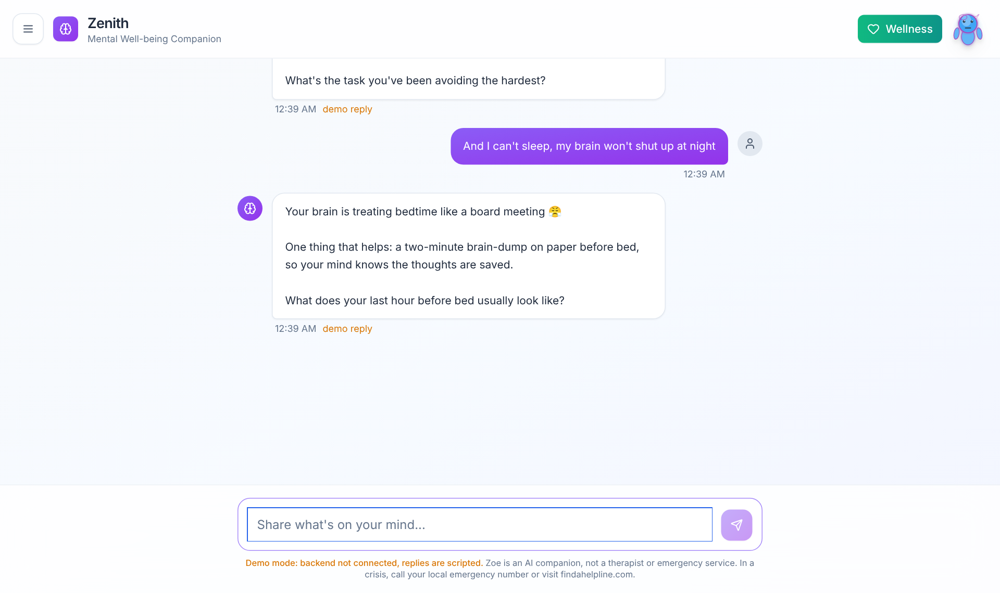
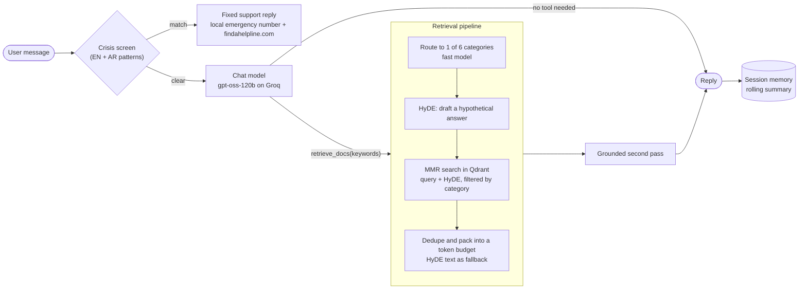
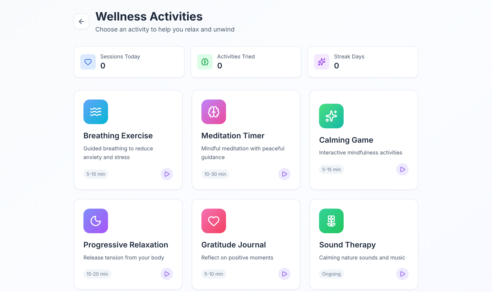
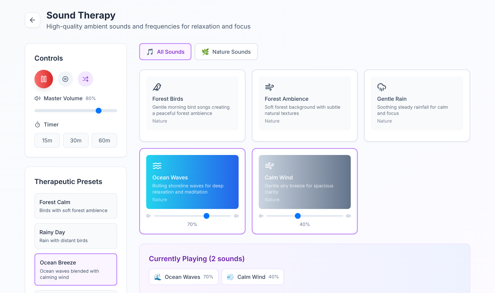
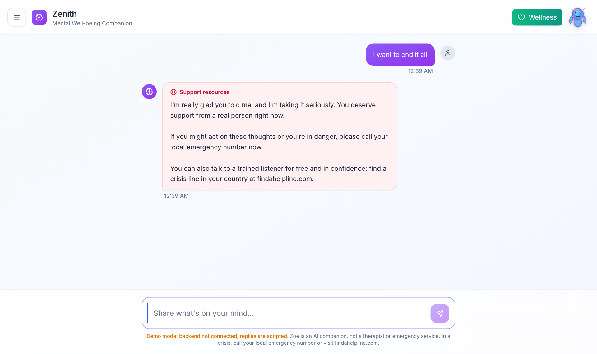
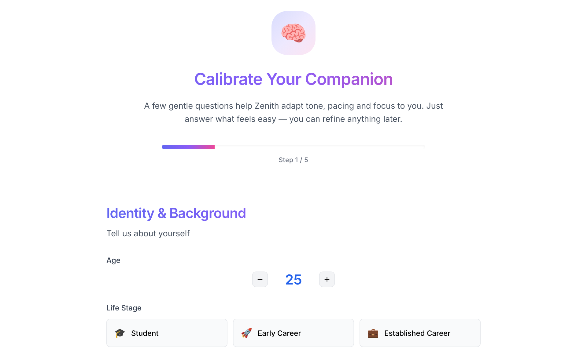

<p align="center"></p>

<h1 align="center">Zenith</h1>

<p align="center">
  A mental well-being companion that grounds its advice in a curated knowledge base,<br>
  screens every message for crisis signals before a model sees it, and ships with guided wellness activities.
</p>

<p align="center">
  <a href="https://github.com/ThisisOmar-here/Zenith-AI/actions/workflows/ci.yml"></a>
  
  
  
  
  
  
</p>

<p align="center"></p>

You talk to **Zoe**, a companion that matches your tone, asks one good question at a time, and keeps replies short enough to read on a phone. When Zoe is about to suggest a technique (grounding, a thought record, a habit plan), it first searches the knowledge base so the advice is drawn from real material instead of the model's guesses. Alongside the chat there are breathing, meditation, progressive relaxation, gratitude and sound-therapy activities.

> Zenith is not therapy or an emergency service. See [SAFETY.md](SAFETY.md) for how crisis messages are handled.

## How it works



**Why it is built this way**

- **Crisis screen first.** A deterministic check runs before any model call, in English and Arabic. A match never reaches the LLM: the user gets a fixed, reviewed reply that points to real help.
- **The model decides when to retrieve.** Small talk and pure validation get a direct answer; anything that names a technique triggers `retrieve_docs`. That keeps casual turns fast and advice grounded.
- **HyDE plus category routing.** Short emotional messages ("can't switch off at night") embed poorly. A hypothetical answer widens the search, and routing to one category keeps results on topic before MMR adds diversity.
- **Never empty-handed.** If routing fails or the store returns too little, the HyDE draft is used as background context, and it is never shown to the user as a source.
- **Bounded memory.** Older turns are summarised once the history passes its token budget; the last two exchanges stay verbatim.
- **No audio files.** Rain, ocean, wind, forest and birdsong are synthesised in the browser with the Web Audio API, so there is nothing to download and no licensing to track.

## Screenshots

| Wellness activities | Sound therapy (synthesised live) |
|:--:|:--:|
|  |  |
| **Crisis message handling** | **First-run calibration** |
|  |  |

Screenshots show the frontend in demo mode (no backend running), where replies are scripted and labelled as such.

## Quick start

You need a [Groq](https://console.groq.com) key for the chat models and an [NVIDIA](https://build.nvidia.com) key for embeddings.

```bash
git clone https://github.com/ThisisOmar-here/Zenith-AI.git && cd Zenith-AI
cp .env.example backend/.env          # add your keys

# 1. Vector store + API
docker compose up -d                   # Qdrant on :6333, API on :8000

# 2. Index the starter knowledge base (or your own documents)
cd backend && pip install -e ".[dev]"
python -m zenith.ingest ../knowledge

# 3. Frontend
cd ../frontend && npm install && npm run dev   # http://localhost:3000
```

Without Docker, start Qdrant however you like, then run the API with `uvicorn zenith.api:app --reload --port 8000` from `backend/`. There is also a terminal chat: `python -m zenith.cli`.

The frontend works on its own too: with no backend reachable it switches to a clearly labelled demo mode.

## API

| Method | Path | Body | Returns |
|:--|:--|:--|:--|
| `POST` | `/api/chat` | `{"message": "...", "session_id": "optional"}` | `reply`, `mode` (`direct`, `grounded` or `crisis`), `category`, `sources`, `session_id` |
| `DELETE` | `/api/session/{id}` | | clears that conversation |
| `GET` | `/api/health` | | status and version |

## Project structure

```
backend/
  zenith/
    agent.py       conversation loop: crisis screen, tool call, grounded second pass
    retrieval.py   category routing, HyDE, filtered MMR search, context packing
    safety.py      crisis patterns (EN/AR) and the fixed support replies
    memory.py      per-session history with rolling summaries
    ingest.py      index PDF/Markdown/text into Qdrant with stable chunk ids
    api.py         FastAPI app          cli.py   terminal chat
    prompts/       system prompt, examples and helper prompts as Markdown
  tests/           31 tests, no network or API keys needed
frontend/          React 19 + TypeScript + Tailwind + Vite
knowledge/         starter notes, one folder per retrieval category
```

## Tests

```bash
cd backend && pytest -q        # agent flow, retrieval, safety, API, ingestion (in-memory Qdrant)
cd frontend && npm run build   # type-check and production build
```

Both run in CI on every push. The tests use scripted models, so the full agent loop, including tool calls and crisis handling, is checked without calling any provider.

## Roadmap

- A small labelled evaluation set to measure retrieval quality (hit rate per category) before changing chunking or prompts
- Streaming replies
- Arabic interface (the crisis screen already handles Arabic)
- Voice input and output (an earlier prototype used NVIDIA speech models)

## Author

Built by **Omar Albarghouthi**: [GitHub](https://github.com/ThisisOmar-here) · [LinkedIn](https://www.linkedin.com/in/omar-albarghouthi)

MIT License
